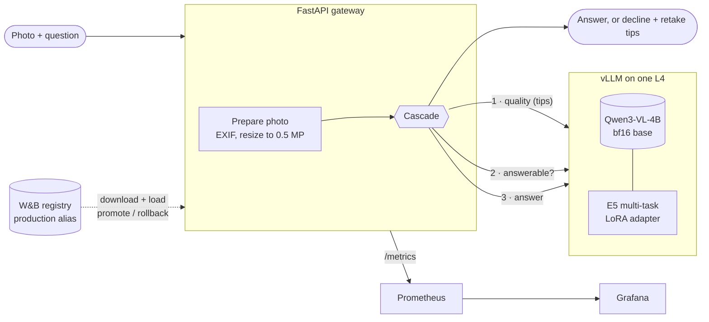
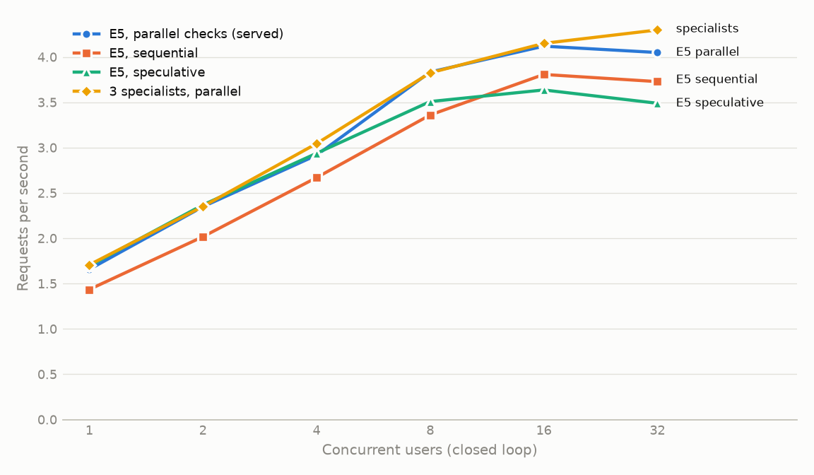

# VizWiz Visual Assistant

A visual question-answering assistant for blind and low-vision users. You send a
photo and a question; it answers briefly, or says it cannot answer from this photo
and how to take a better one. **It prefers declining to guessing.**

One small vision-language model (Qwen3-VL-4B-Instruct) is fine-tuned with LoRA on
the human-labelled [VizWiz](https://vizwiz.org) datasets and served with vLLM
behind a FastAPI gateway that runs a three-stage cascade. Everything was trained
and measured on a single NVIDIA L4 (24 GB) in Google Colab.

## Results at a glance (VizWiz test split, our held-out set)

| | Untrained model | **This system** |
|---|---|---|
| Official VizWiz accuracy, end to end (a decline counts as "unanswerable") | 47.1 | **77.7** |
| Wrong answers, share of all questions | 52.8% | **14.8%** |
| Unanswerable questions answered anyway | 100% | **2.7%** |
| Answering accuracy on answerable questions | 53.5 | **62.6** |
| Detecting unanswerable questions (average precision) | 69.4 | **90.0** |
| Photo-quality issues (macro-F1, 7 labels) | 28.0 | **65.6** |

The cost of the safety-first setting: 28.6% of answerable questions are declined
(with retake tips). The decline threshold is one config value; the full trade-off
curve is in [`results/serve/serve-check`](results/serve/serve-check/README.md).

**Read the [results write-up](docs/results_writeup.md)** for the full story: what
worked, what did not, and why.

All comparisons are paired on the same test examples with bootstrap 95% confidence
intervals; reading rules were fixed before each run and logged in
[`DECISIONS.md`](DECISIONS.md).

## How it works



1. **Quality** lists photo problems (blur, framing, rotation, dark, bright,
   obstruction, unrecognizable). They become fixed, reviewed retake tips such as
   *"The photo is too dark. Turn on a light or move near a window."*
2. **Answerability** gives P(unanswerable) from the first-token log-probabilities.
   At ≥ 0.10 (chosen on val) the reply is a decline plus tips.
3. **Answer** gives a short answer otherwise.

Stages 1 and 2 run concurrently. Two other modes, sequential (least GPU work) and
speculative (all three at once), are compared in the load test. All three stages
use one multi-task LoRA adapter on a shared base model.

## What was learned (experiments)

| Experiment | Result | Decision |
|---|---|---|
| **E1** zero-shot baseline | Answers too long; 37% of answerability replies not even a label; "unrecognizable" photos almost never detected (F1 0.01) | Fine-tune |
| **E2** one LoRA adapter per task (r 16, 1 epoch) | Answering +8.2 [+7.0, +9.3]; answerability AP +20.8 [+18.5, +22.9]; quality macro-F1 +37.2 [+35.9, +38.7] | Big gains on all three |
| **E5** one multi-task adapter vs three specialists, same data and compute | Matches all three (answering +0.8 [+0.2, +1.5], others within ±0.4) | **Serve one adapter** (D-056) |
| **E4** FP8 base vs bf16 | −41% weight memory, +55% request capacity, +14% speed; quality macro-F1 −0.6 [−1.2, −0.0] misses the pre-set −1 point margin by 0.16 | Keep bf16; FP8 is a documented option (D-058) |
| Served path vs offline eval | JPEG re-encoding changed 8% of answers (no measurable accuracy change); lossless PNG brings agreement to 97–100% per stage | Serve PNG (D-063, D-066) |
| Hard "retake" gate on unrecognizable photos | Lowers accuracy 0.7–1.6 points, mostly by declining answerable questions | Quality gives tips only (D-064) |
| Image resolution 0.26 / 0.52 / 1.05 MP (zero-shot, val) | 0.52 MP: answering 55.9 vs 56.1 at 1 MP, at twice the speed (8 vs 4 examples/s) | 0.52 MP by the pre-set rule (D-047, D-050) |

Skipped on purpose, with reasons in `DECISIONS.md`: QLoRA (LoRA fits on the L4,
D-053), extra tuning runs (no evidence they would pay off, D-053), 4-bit
quantization (FP8 tried first, D-057).

**Error analysis** ([`results/error_analysis`](results/error_analysis/README.md)):
answering accuracy is 89.6 when 7+ of 10 annotators agree and 37.2 when at most 3
do, so much of the remaining error is ambiguity in the labels. Answerability
errors concentrate on borderline questions where annotators split 3–5 of 10.

## Serving system

- **Gateway** (`src/vizwiz/serve/gateway.py`): `POST /v1/assist`, `GET /health`,
  `GET /adapters`, `GET /metrics`; retries with backoff on model-server errors,
  then 503. It never answers without both checks.
- **Adapter registry** (`registry.py`, `adapters.py`): adapters are versioned W&B
  artifacts. The gateway loads the `production` version at startup. Promote and
  rollback swap adapters on the live server with no restart (download, load,
  move the alias, switch). Incompatible adapters are refused. Admin endpoints need
  a token.
- **Privacy by design:** logs and metrics hold ids, timings, statuses and quality
  labels only, never photos, questions or answers.
- **Photos are sent losslessly (PNG)**, so served replies match the evaluated
  model (97–100% agreement per stage; D-066).

### Performance on one L4 ([details](results/bench/load-test/README.md))

| | E5, parallel checks (served) |
|---|---|
| Latency, one user | p50 0.61 s, p95 0.88 s |
| Throughput within p95 < 2 s | **2.92 requests/s** (each request = 3 model calls) |
| Peak throughput | 4.12 requests/s |
| Cost per 1,000 requests (GCP L4 at $0.707/h, fully busy) | **$0.067** |
| Failures in the load test | 0 of 4,436 requests |
| Registry: resolve + download + load an adapter into the live server | 6.0 s |



- Running stages 1 and 2 together beats both sequential and speculative
  execution under load.
- One multi-task adapter and three specialists serve at the same speed: vLLM
  batches across adapters. E5 wins on operations (one artifact) and accuracy.
- The GPU is compute-bound (KV cache ≤ 31% used): each request encodes the photo
  three times. Sharing that work across stages is the main open optimisation.
- Three merged models would not fit on one L4 (≈ 25.5 GiB of weights); multi-LoRA
  serves all adapters from one base for +0.2 GiB.

### Run the full stack locally (no GPU)

A mock model server stands in for vLLM, so the gateway, cascade and monitoring run
on a laptop:

```bash
docker compose -f docker/docker-compose.yml up --build -d
docker compose -f docker/docker-compose.yml --profile demo run --rm traffic   # synthetic photos
```

- Results dashboard: http://localhost:8501
- Grafana dashboard: http://localhost:3000
- API docs: http://localhost:8080/docs
- Prometheus: http://localhost:9090

Ports bind to localhost only. CI builds and smoke-tests this stack on every push.

### Dashboard

[`dashboard/`](dashboard/) is a Next.js site presented as a product, **Glimpse**
(a placeholder name, set in `dashboard/src/lib/brand.ts`):

- **Home** (`/`): what it does, in plain words, and *Try it*: pick one of five openly
  licensed photos (CC0, not VizWiz), tap **Ask**, and hear the reply (**Listen** reads
  it aloud). Replies are recorded from the fine-tuned model; while the AWS GPU server
  is on, **Ask** goes to the live model.
- **Research** (`/research`): how the cascade works, every field the model returned
  for the demo photos, then the numbers: headline results, the decline-threshold
  trade-off, load-test latency and cost, experiment comparisons with 95% intervals,
  and the error analysis.

Stack: Next.js 16 (App Router), tRPC 11 with zod inputs, TanStack Query, Recharts,
and `node:sqlite`. On every `dev` or `build`, `scripts/build-db.ts` loads the
committed `results/*.json` into `dashboard/data/results.db`; the tRPC procedures
read only that database.

```bash
cd dashboard && npm ci && npm run dev    # http://localhost:3001, needs Node 22.18+
```

To host it on Vercel, import the repo and set the project's root directory to
`dashboard` (it reads `../results` while building).

**Saved try-it answers:** run [`notebooks/16_demo_answers.ipynb`](notebooks/16_demo_answers.ipynb)
on a Colab L4 (~15 min) and commit its `answers.json` as `results/demo/answers.json`.

### Live model on AWS (off by default)

[`infra/aws/`](infra/aws/README.md) is Terraform for one g6.xlarge (NVIDIA L4) running
vLLM and the gateway. **Off costs $0**: with `enabled = false` (the default) no
billable resource exists. `terraform apply -var enabled=true` turns it on (~$0.80/hour,
ready in ~10–15 min, terminates itself after 2 hours); `-var enabled=false` turns it
off. Then set `VIZWIZ_GATEWAY_URL` and `VIZWIZ_API_KEY` for the dashboard. Needs an
AWS GPU quota increase first; see the README there.

## Model card

- **Intended use:** a research prototype of an assistant that answers short
  questions about everyday photos taken by blind and low-vision people.
- **Not for:** medication, allergy, safety or medical decisions. **This is not a
  safety device.** About 1 in 7 questions asked still gets a wrong answer, which
  is 30% of the answers it gives (the rest are declined).
- **Training data:** VizWiz-VQA and VizWiz image-quality annotations (human labels
  only, CC BY 4.0). The val split is carved from the official train split,
  grouped by image. Test = official val.
- **Known limitations:**
  - It declines often (28.6% of answerable test questions), by design.
  - Reading text and counting are its weakest skills (58.1 and 53.1 accuracy).
  - Rare photo problems (obstruction, dark, bright) are detected less reliably
    (F1 0.45–0.58).
  - English only.
  - Behaviour on photos unlike VizWiz's is untested.
- **Privacy:** VizWiz photos can contain private information. This repo never
  stores, shows or uploads dataset images. Committed results are aggregate
  numbers only. Demos use synthetic or the owner's own photos.

## Reproduce

GPU steps run in Colab from thin launcher notebooks; each pins the environment,
checks data hashes against `results/splits/files.json`, and resumes after a
disconnect.

| Step | Notebook | GPU |
|---|---|---|
| Data download, labels and splits | `01_data_download`, `02_data_prep` | CPU |
| Baseline (E1) | `04_e1_baseline` | L4 |
| Specialist adapters (E2) | `07_e2_answer`, `08_e2_answerability`, `09_e2_quality` | L4, ~10 h total |
| Error analysis | `10_error_analysis` | CPU |
| Multi-task adapter (E5) | `11_e5_multitask` | L4, ~10 h |
| FP8 serving (E4) | `12_e4_fp8` | L4 |
| Served-path check and threshold | `13_serve_check`, `14_serve_parity` | L4, CPU |
| Load test and registry | `15_load_test` | L4 |

Every result file records the git commit, config and package versions.

### Development

```bash
python3.11 -m venv .venv && source .venv/bin/activate
pip install -e ".[dev,serve]"
ruff check . && pytest
```

## Repository map

```
src/vizwiz/data     download, labels, splits, prompt formatting
src/vizwiz/train    LoRA SFT entrypoint with time-based checkpoints and resume
src/vizwiz/eval     vLLM batch evaluation, metrics, paired bootstrap, error analysis
src/vizwiz/serve    gateway, cascade, guidance, registry, mock model, replay/tuning
src/vizwiz/bench    Locust load test, sweep runner, demo traffic
configs/            data, training and serving settings
results/            committed metrics (aggregate only)
dashboard/          dashboard: how it works, try it, results (Next.js, tRPC, SQLite)
infra/aws/          Terraform for the on-demand GPU server (off by default)
docker/, monitoring/  Compose stack, Prometheus, Grafana dashboard
```

The plan is in [`PROJECT_PLAN.md`](PROJECT_PLAN.md). Every decision, failure and
workaround is in [`DECISIONS.md`](DECISIONS.md).

## Data and attribution

This project uses the VizWiz datasets (https://vizwiz.org), licensed under
[CC BY 4.0](https://creativecommons.org/licenses/by/4.0/). VizWiz-VQA: D. Gurari et al.,
"VizWiz Grand Challenge: Answering Visual Questions from Blind People," CVPR 2018.
Image quality issues: T. Chiu et al., "Assessing Image Quality Issues for Real-World
Problems," CVPR 2020. Labels are derived from the original annotations. See
[`docs/data_licenses.md`](docs/data_licenses.md).
