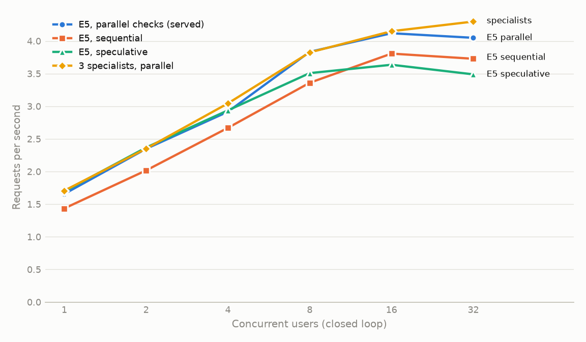
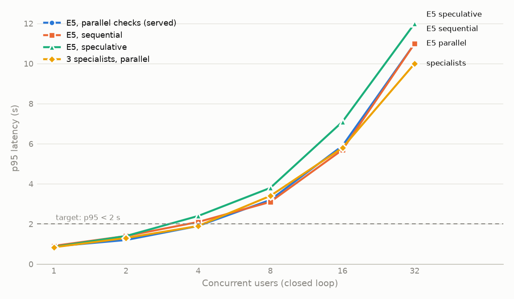

# Load test, cost and registry (Steps 6.1–6.2, D-065, D-066)

One NVIDIA L4 (24 GB) in Colab: vLLM 0.32.0 serving Qwen3-VL-4B (bf16) with four
LoRA adapters loaded (E5 and the three specialists), the FastAPI gateway in front,
and Locust 2.47.0 sending 300 real val photos and questions. Closed loop: each user
sends the next request as soon as the reply arrives. 10 s warm-up, then 60 s
measured per level. **No request failed** (0 of 4,436). Numbers: `sweep.jsonl`,
`summary.md`; versions and memory: `server_info.json`.

## Headline (served configuration: E5, parallel checks)
| | Value |
|---|---|
| Latency, one user at a time | p50 0.61 s, p95 0.88 s |
| Throughput within the target (p95 < 2 s) | **2.92 requests/s** at 4 concurrent users (p95 1.9 s) |
| Peak throughput | 4.12 requests/s at 16 users (p95 5.9 s) |
| GPU memory | weights 8.7 GiB (base + 4 adapters), KV cache 6.7 GiB (~48k tokens) |
| Peak KV-cache use, 32 users | 30% |

Every request is three model calls (quality, answerability, answer), each with
about 600 tokens of photo and prompt, so the peak of ~4 requests/s is ~12 model
calls/s.

## What the comparison shows
| Configuration | 1 user p50 | Best req/s with p95 < 2 s | Peak req/s |
|---|---|---|---|
| **E5, parallel checks (served)** | 610 ms | **2.92** (4 users) | 4.12 |
| E5, sequential | 720 ms | 2.02 (2 users) | 3.81 |
| E5, speculative | 580 ms | 2.37 (2 users) | 3.64 |
| 3 specialists, parallel checks | 630 ms | 3.04 (4 users) | 4.30 |

- **Parallel checks is the right default.** Sequential gives no saving now that
  quality only gives tips (all three calls always run), so it is just slower.
  Speculative is fastest for a lone user (580 vs 610 ms) but sends an answer call
  that is thrown away on every decline (40–50% of requests), so it loses
  throughput under load.
- **One adapter vs three costs nothing in speed.** vLLM batches requests for
  different adapters together; the specialists are within noise of E5 (3.04 vs
  2.92 req/s at the target). E5's advantage is operational (one artifact to
  version, promote and roll back) and slightly better answering accuracy (D-056).
- **The limit is GPU compute, not memory.** KV-cache use never passes 31%, so
  more cache (e.g. FP8, D-058) would not raise throughput here. The photo is
  processed three times per request, once per stage; reusing it across stages
  (putting the photo before the task prompt so the stages share a cached prefix)
  is the clearest next optimisation, but needs retraining with that prompt order.

## Cost per 1,000 requests
Assumption: Google Cloud `g2-standard-4` (1 × L4, 4 vCPU, 16 GB), on-demand,
us-central1, **$0.707/hour** (Google Cloud accelerator-optimized pricing, checked
2026-11-20). Spot is about $0.62/hour.

| Configuration and load | Requests/hour | Cost per 1,000 requests |
|---|---|---|
| E5 parallel, within p95 < 2 s (2.92 req/s) | 10,512 | **$0.067** |
| E5 parallel, peak (4.12 req/s, p95 5.9 s) | 14,832 | $0.048 |
| E5 sequential, within target (2.02 req/s) | 7,272 | $0.097 |
| 3 specialists, within target (3.04 req/s) | 10,944 | $0.065 |

This assumes the GPU is busy all the time; idle hours cost the same.

**Merged-model baseline:** serving the three specialists as three merged bf16
models needs about 3 × 8.5 GiB ≈ 25.5 GiB for weights alone, more than the L4's
~22.5 GiB before any request cache, so it needs three GPUs (about 3× the cost per
hour). Multi-LoRA keeps one base model; the four adapters add about 0.2 GiB
(8.74 vs 8.51 GiB loaded).

## Registry (first real run)
- E5 uploaded to W&B as `e5-multi-lora:v0` and marked `production`.
- Gateway started from the registry: resolve the version, download, load into
  the running vLLM server and switch the stages in **6.0 s**. All three stages
  then served `e5-multi-lora-v0`, and 5 of 5 requests succeeded.
- A rollback with no previous version was refused (HTTP 409); nothing changed.

## Lossless photos (PNG) restore parity (D-066)
Same val replay as the serving check, with PNG instead of JPEG:

| Stage | JPEG agreement | **PNG agreement** | Bar (D-060) | PNG accuracy, served − offline |
|---|---|---|---|---|
| Answerability decision | 98.8% | **99.6%** | ≥ 98% | AP −0.07 [−0.22, +0.07] |
| Answers | 92.2% | **97.4%** | ≥ 95% | −0.21 [−0.64, +0.23] |
| Quality labels | 90.1% | **96.4%** | ≥ 90% | −0.56 [−1.24, +0.00] |

PNG passes all three bars, so it is now the served default. Measured cost: about
10 ms more CPU per photo to encode (0.7 MB vs 0.3 MB per call, on localhost),
under 2% of the median latency. The load test above was run with JPEG.
